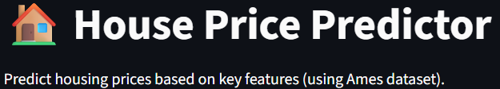
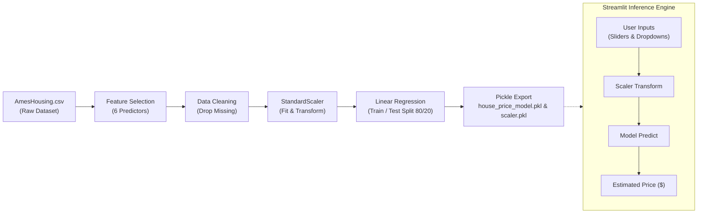

# 🏡 House Price Predictor – ML Web App

An end-to-end Machine Learning web application predicting residential property prices using the Ames Housing dataset. Built with **Python**, **scikit-learn**, and deployed interactively via **Streamlit**.

---



## 📌 Project Overview

This application predicts home sale prices based on core structural and spatial attributes. It provides an intuitive web interface for real-time inference with standardized feature transformations.

- **Dataset**: Ames Housing Dataset (2,930 observations across residential properties in Ames, Iowa).
- **Model Architecture**: Ordinary Least Squares (OLS) Linear Regression (`sklearn.linear_model.LinearRegression`).
- **Data Preprocessing**: Feature subset selection and Z-score standardization using `StandardScaler`.
- **Serialization**: Pretrained weights and fitted scaler serialized with `pickle`.
- **Live Deployment**: Hosted on Streamlit Community Cloud.

🔗 **Live Application:** [https://housepricepredictorbynarasimhamanam.streamlit.app/](https://housepricepredictorbynarasimhamanam.streamlit.app/)

---

## 🏗️ Architecture & Pipeline



---

## 📊 Feature Specification

The model consumes 6 key structural and quality indicators from the Ames dataset:

| Feature | Raw Name in Ames | Type | Description |
| :--- | :--- | :--- | :--- |
| **Lot Area** | `Lot Area` | Continuous | Lot size in square feet (1,300 – 20,000 sq ft) |
| **Year Built** | `Year Built` | Discrete | Original construction year (1872 – 2010) |
| **Total Basement SF** | `Total Bsmt SF` | Continuous | Total square feet of basement area |
| **Above Ground Living Area** | `Gr Liv Area` | Continuous | Above grade living area square feet (334 – 5,642 sq ft) |
| **Garage Capacity** | `Garage Cars` | Discrete | Size of garage in car capacity (0 – 4 cars) |
| **Overall Quality** | `Overall Qual` | Ordinal | Overall material and finish rating (1 = Very Poor, 10 = Very Excellent) |

**Target Variable**: `SalePrice` (Continuous, USD).

---

## 🛠️ Tech Stack

| Domain | Technology |
| :--- | :--- |
| **Language** | Python 3.10+ |
| **Core Libraries** | `scikit-learn`, `pandas`, `numpy` |
| **UI & Serving** | Streamlit |
| **Serialization** | Pickle |
| **Hosting** | Streamlit Community Cloud |

---

## 📁 Repository Structure

```
House_Price_predictor/
├── AmesHousing.csv              # Training dataset
├── app.py                       # Streamlit web interface and inference logic
├── train_model.py               # Model training and artifact serialization script
├── house_price_model.pkl        # Serialized LinearRegression model
├── scaler.pkl                   # Serialized fitted StandardScaler
├── requirements.txt             # Python dependencies
├── .gitignore                   # Git exclusion rules
├── assets/
│   ├── Banner.png               # Readme banner
│   └── liveat.png               # UI badge
└── README.md                    # Project documentation
```

---

## 🚀 Getting Started

### 1. Prerequisites

- Python 3.10 or higher
- Git

### 2. Clone the Repository

```bash
git clone https://github.com/Narasimhamanam/House_Price_predictor.git
cd House_Price_predictor
```

### 3. Create a Virtual Environment

```bash
# macOS/Linux
python3 -m venv venv
source venv/bin/activate

# Windows (Command Prompt / PowerShell)
python -m venv venv
.\venv\Scripts\activate
```

### 4. Install Dependencies

```bash
pip install -r requirements.txt
```

### 5. (Optional) Retrain the Model

To retrain the Linear Regression model on `AmesHousing.csv` and re-export the pickle artifacts:

```bash
python train_model.py
```

### 6. Run the Application

Launch the Streamlit dashboard locally:

```bash
streamlit run app.py
```

Open [http://localhost:8501](http://localhost:8501) in your browser.

---

## ⚖️ Engineering Notes & Limitations

- **Linearity Assumption**: Standard OLS linear regression assumes linear relationships between features and sales price. While highly interpretable, non-linear effects (such as diminishing returns on large lot sizes or neighborhood-level premiums) can be captured in future iterations using regularized tree-based models (e.g., XGBoost, LightGBM) or polynomial feature expansion.
- **Outlier Sensitivity**: Linear models can be sensitive to extreme valuations in the Ames dataset; features are standardized with `StandardScaler` to stabilize gradient descent and coefficient scales.
